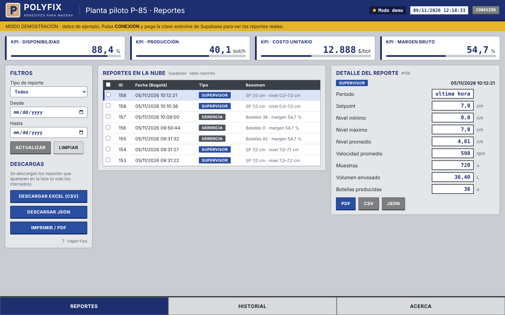
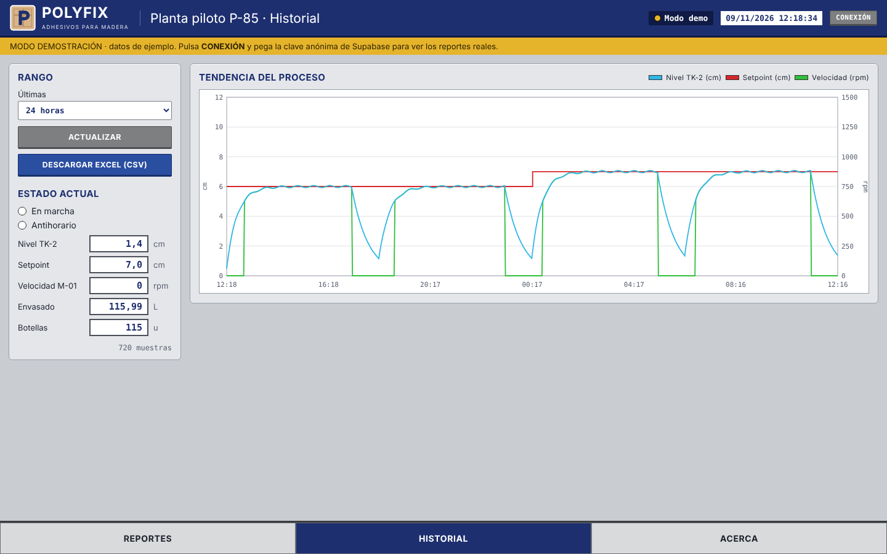

# POLYFIX · Reportes en la nube

Interfaz web tipo SCADA para **consultar y descargar los reportes** de la planta piloto POLYFIX P-85 guardados en **Supabase**. Tiene el mismo estilo de las pantallas WinCC del proyecto (Operador, Supervisor, Gerencia).



## Qué hace
- **Reportes:** lista los reportes de supervisor y de gerencia de la tabla `reportes`, con filtros por tipo y fecha (hora de Colombia), y muestra el detalle con indicadores como en el HMI.
- **KPI:** disponibilidad, producción, costo unitario y margen del último reporte de gerencia.
- **Descargas:** Excel (CSV con `;` y coma decimal), JSON y PDF (vista de impresión), ya sea de todos los reportes, de los marcados o de uno solo.
- **Historial:** tendencia de nivel, setpoint y velocidad desde la tabla `proceso` (1 h a 30 días), con descarga en CSV.



## Cómo se conecta
```
HMI (REPORTE EN LA NUBE) → PLC 1516 · DB4 "Nube" → Node-RED → MySQL (local) + Supabase (nube) → esta página
```
La página usa la API REST de Supabase con la **clave anónima**. RLS en Supabase solo permite leer e insertar, así que la clave anon puede ir en una página pública. **Nunca** uses la `service_role`.

## Configuración
1. En Supabase: *Project Settings → API*, copia la **Project URL** y la clave **anon / publishable**.
2. Pégalas en `js/config.js` (usa la **Publishable key**, nunca la Secret key).
3. Las políticas RLS deben permitir `select` al rol `anon` en `reportes` y `proceso`:
```sql
create policy "leer reportes" on public.reportes for select to anon using (true);
create policy "leer proceso"  on public.proceso  for select to anon using (true);
```

## Publicar con GitHub Pages
*Settings → Pages → Deploy from a branch → `main` / root*. La página queda en `https://<usuario>.github.io/<repositorio>/`.

## Estructura
```
index.html        pantallas (Reportes, Historial, Acerca)
css/scada.css     estilo SCADA (ISA-101) + vista de impresión
js/config.js      URL y clave anon de Supabase
js/app.js         lectura REST, filtros, descargas y tendencia
img/logo.svg      logo
```
No usa librerías ni compilación: es HTML, CSS y JavaScript puro.

---
Universidad Militar Nueva Granada · Ingeniería Mecatrónica · Automatización Industrial 2026-2
Valentina Restrepo · Brayan Santiago Macias Real · Santiago Pirachican
